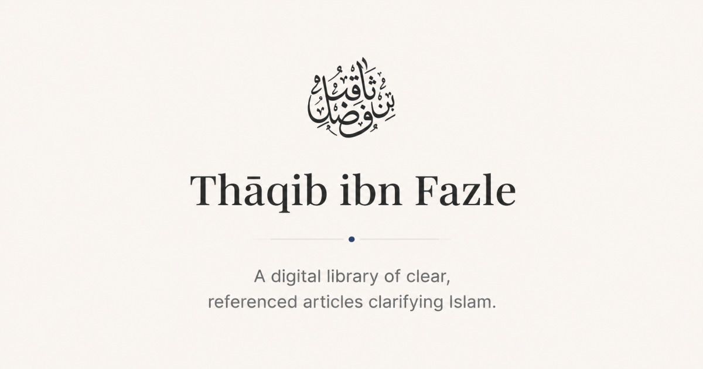

A fast, minimal website for publishing clear, referenced articles clarifying Islam.

🌐 **Website:** https://ibnfazle.com

## About

This website was created after I began to teach at an Islamic school to digitize notes from durūs I attended over the years with my mashāyikh.

What started as a way to strengthen my own retention as a ṭālib al-'ilm gradually became a growing collection of English-language articles that serve as a point of reference for me when teaching. 

## Content library

The library combines Articles, PDFs, and Q&A, with content-type filters, category filters, search, and pagination. Filter and search selections are kept in the URL. Existing article and PDF URLs remain unchanged.

Create questions under **Q&A** in Sanity Studio. Enter a short, descriptive **Title**, the complete original **Full Question**, slug, answer summary, date, and answer; categories, tags, and a 16:9 thumbnail are optional. The title appears in the page heading, library, and social previews. The full question retains its paragraphs beneath **The Question**, followed by **The Answer**. Thumbnails appear in library and featured cards, question pages, and social previews, using the same presentation as articles and PDFs. Cards without a thumbnail use the shared placeholder. Answers use the same Markdown format as articles, including paragraphs, `##` headings, links, and footnotes (`[^1]` with a corresponding `[^1]: Source` definition). Questions can also be linked in category cluster sections.

Published questions appear at `/questions/[slug]`; `/questions` opens the library with Q&A selected. This is a static site, so content changes appear after the next site build and deployment. Deploy the updated Studio to make its Q&A editor available to editors. For older entries that stored the full question in `title`, copy it into **Full Question** before shortening **Title**; keep the existing slug to preserve URLs. Until updated, the frontend uses the existing title as the question. Entries with only a `question` also use it as the heading until a concise title is supplied. No automated content rewrite is performed.

Run `npm run check`, `npm test`, `npm run build`, and `npm run studio:build` to validate changes. The tests build against a local Sanity fixture dataset and never write to the production CMS.

